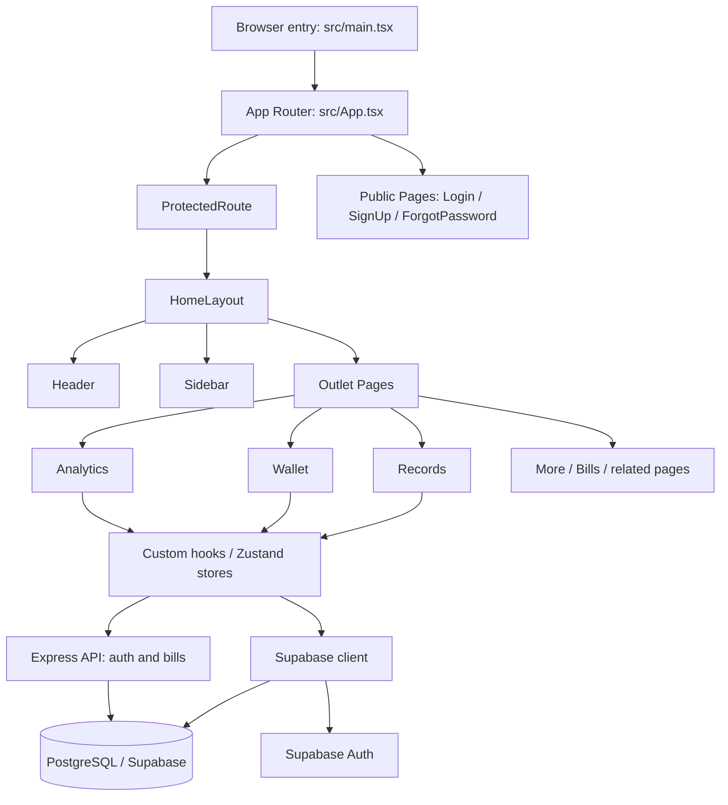

# Project Documentation

## 1. Project Overview

### Project name
This application is a personal finance management app. In the login flow the UI labels it as “Itrack Money,” while the app metadata in `public/manifest.json` names it “Financial Management.” The implementation is a single-page React application for tracking spending, balances, and monthly cash flow.

### Purpose and goals
The project is focused on helping a user:
- record individual spending items with categories and payment methods;
- maintain account balances and track money movement across accounts;
- view recent transactions and overview data by date range;
- visualize monthly spending and cash-flow trends;
- manage a personal wallet and account list with account-level balances;
- log in with email/password, Google OAuth, or a demo account through Supabase authentication.

### Problems the application solves
The codebase is oriented around daily personal finance tracking:
- categorizing where money is spent;
- balancing account amounts when a transaction is added;
- consolidating monthly and daily spending totals for review;
- providing account information in the app, with finance data accessed directly through Supabase and selected API functionality handled by the backend service.

### Target users
The app appears intended for individuals managing personal budgets rather than a multi-tenant business product. The user model is tied to a Supabase auth user and each record is filtered by `owner` and `account_owner` values.

### Main features and capabilities
Confirmed features from the actual implementation include:
- user authentication with email/password and Google OAuth through the backend API and Supabase Auth;
- protected routing requiring a valid session;
- wallet/account management with add-account flow and available-balance summary;
- expense entry form with category, subcategory, title, price, and payment method;
- transaction record persistence to the `items` table and account balance updates;
- transaction history and account detail views;
- monthly cash-flow analytics powered by a database RPC function;
- calendar-month spending summaries and prediction-style analysis UI;
- dark-mode toggle and responsive layout for desktop/mobile screens;
- installable web-app metadata (`manifest.json`) and a simple service worker registration.

### Current implementation status
The project includes a React frontend backed by Supabase and a separate Express backend service. The frontend accesses Supabase directly for much of its finance data, while the backend provides API routes for authentication and bills. The frontend is deployed on Vercel and the backend is deployed on Render. Several routes and UI elements are present but partially commented out or clearly reserved for future features, which suggests the project is in active but not complete production refinement.

---

## 2. Technology Stack

Versions below are the declared versions or ranges in the corresponding package manifest.

### Frontend stack

| Technology | Version | Purpose and usage |
|---|---:|---|
| React | ^19.1.0 | UI rendering throughout `src/App.tsx`, pages, and components |
| TypeScript | ~5.8.3 | Static typing and TSX support |
| Vite | ^7.0.0 | Development server and production bundling |
| Tailwind CSS / `@tailwindcss/vite` | ^4.1.11 | Utility-first styling and Vite integration |
| React Router DOM | ^7.6.3 | Application navigation and protected routes |
| Zustand | ^5.0.6 | Local state for sessions, accounts, spending, and UI |
| `@supabase/supabase-js` | ^2.118.0 | Direct frontend access to Supabase auth, PostgreSQL, and RPCs |
| Axios | ^1.20.0 | HTTP client for calls to the backend API |
| Chart.js / `react-chartjs-2` | ^4.5.1 / ^5.3.1 | Financial charts and their React components |
| date-fns | ^4.1.0 | Date formatting and date-range logic |
| react-icons | ^5.5.0 | Icons across navigation, wallet, and auth UI |
| framer-motion | ^12.23.11 | UI animations |
| FullCalendar (`@fullcalendar/react`, `@fullcalendar/daygrid`) | ^6.1.18 | Monthly calendar display |
| `@number-flow/react` / `number-flow` | ^0.5.10 / ^0.5.8 | Animated monetary values |
| react-spinners | ^0.17.1 | Loading indicators |
| millify | ^6.1.0 | Compact formatting for large totals |
| Vitest | ^3.2.4 | Unit testing |
| ESLint | ^9.30.0 | Static analysis and style enforcement |
| react-scan | ^0.4.3 | Runtime diagnostics, enabled from `src/main.tsx` |

### Backend stack

| Technology | Version | Purpose and usage |
|---|---:|---|
| Node.js | Not pinned in `backend/package.json` | Runtime for the backend service |
| Express | ^5.3.0 | HTTP server and API routing |
| `@supabase/supabase-js` | ^2.118.0 | Backend access to Supabase |
| cors | ^2.8.6 | Configured cross-origin access |
| dotenv | ^18.0.8 | Loads environment variables |
| helmet | ^8.3.0 | HTTP security headers |
| express-rate-limit | ^8.7.1 | Request rate limiting dependency |
| Zod | ^4.6.7 | Request data validation |
| nodemon (development) | ^3.1.14 | Restarts the backend during local development |

### Deployment

| Application | Platform | Configuration |
|---|---|---|
| Frontend | Vercel | Root `vercel.json` installs and builds the frontend and serves its Vite output with SPA rewrites |
| Backend | Render | The Express API service is deployed on Render; its package start script runs `node src/server.js` |

### Observed technology usage notes
- The project has separate React + TypeScript + Vite frontend and Node.js + Express backend applications.
- The frontend and backend both use Supabase; the frontend also queries Supabase directly for finance data and analytics RPCs.
- The Express backend mounts authentication and bills API routes.
- Tailwind v4 is active via the Vite plugin and custom theme tokens defined in `src/index.css`.
- The frontend is hosted on Vercel and the backend is deployed on Render.

---

## 3. Dependencies and Imports

### Core framework imports
These are the dominant import patterns in the project:

- React and JSX entry points:
  - `import React from 'react';` (legacy style in some files)
  - `import { StrictMode } from 'react'` in `src/main.tsx`
- Routing and page transitions:
  - `import { BrowserRouter, Routes, Route, Navigate, useLocation } from 'react-router-dom';`
  - `import { useNavigate, useParams } from 'react-router-dom'`
- Data-driven local state:
  - `import { create } from "zustand";`

Representative usage: `src/App.tsx` sets up the main router, and `src/router/ProtectedRoute.tsx` guards authenticated views.

### UI and component libraries
- `react-icons` is the actual icon library used throughout the app.
- Imports follow direct named imports from package subpaths such as:
  - `import { FcGoogle } from 'react-icons/fc';`
  - `import { FaArrowUp, FaArrowDown } from "react-icons/fa";`
  - `import { LuEye, LuEyeOff } from 'react-icons/lu';`
  - `import { IoCheckmark, IoCloseOutline } from "react-icons/io5";`
- There is no evidence of `lucide-react` or another icon library being used as the primary icon source.

### Routing
The project uses React Router v7 patterns:
- `BrowserRouter` wraps the app at `src/App.tsx`
- `Routes` and `Route` define both public and protected paths
- `ProtectedRoute` checks session validity before allowing access
- route state is used to render modal overlays with `backgroundLocation`

Representative examples:
```tsx
<BrowserRouter>
  <AppRoutes />
</BrowserRouter>
```

### State management
Zustand is used for app-wide state, especially around authentication, spending data, wallet/account data, and UI toggles.

Key stores:
- `src/store/useSession.ts` – stores the current Supabase session
- `src/store/useUserStore.ts` – stores the current auth user
- `src/store/useSpendingStore.ts` – stores transaction lists and fetch state
- `src/store/useAccountStore.ts` – stores bank account list and payment method
- `src/store/useMenuToggle.ts` – stores sidebar open/collapse state
- `src/store/useModal.ts`, `useToastStore.ts`, `useCalendarStore.ts`, `useOverviewDate.ts` – associated UI state

Representative import:
```ts
import { create } from "zustand";
```

### API communication and database access
The frontend interacts directly with Supabase through `@supabase/supabase-js` for finance data and analytics. It also uses Axios to call the Express backend in `../backend` for authentication and bills. The backend uses Supabase for its data and authentication operations.

Representative usage:
```ts
import supabase from '@/lib/supabase';
const { data, error } = await supabase.from('items').select('*');
```

Observed database operations include:
- reading `items` by `owner`
- reading `accounts` by `account_owner`
- inserting into `items` and `transaction`
- updating account balances after a transaction
- calling RPC `get_monthly_cash_flow` to compute monthly analytics

### Authentication
Authentication is provided through backend API endpoints and Supabase Auth. The frontend stores the resulting Supabase session in its session store and listens for Supabase auth-state changes.

Representative imports and patterns:
```ts
import supabase from '@/lib/supabase';
import { useSession } from '@/store/useSession';
```

Actual auth flows include:
- email/password login and signup through the backend API, then session establishment through Supabase Auth;
- Google OAuth URL creation through the backend API;
- sign-out through the backend API and local Supabase session;
- password reset and password update through Supabase Auth;
- demo login through the same backend credentials endpoint.

### Styling
Styling is handled primarily by Tailwind utility classes with custom theme colors defined in `src/index.css`:
```css
@import "tailwindcss";
@custom-variant dark (&:where(.dark, .dark *));
@theme {
  --color-dark:#161B21 ;
  --color-medium-dark: #1D232C;
  --color-light-dark: #222730;
}
```
The app also includes a custom dark mode toggle that adds/removes the `dark` class on `document.documentElement`.

### Data, charts, and formatting
- `date-fns` is used for formatting, date range creation, and calendar calculations.
- `chart.js` and `react-chartjs-2` render charts for budgets and totals.
- `@number-flow/react` provides animated monetary values.
- `millify` is used to compact large currency values in the spending calendar.

Representative imports:
```ts
import { format } from 'date-fns';
import { Doughnut } from 'react-chartjs-2';
import NumberFlow from '@number-flow/react';
```

### Internal modules and aliases
The app uses the `@/*` alias configured in `tsconfig.app.json` and `vite.config.ts`:
```ts
resolve: { alias: { '@': path.resolve(__dirname, 'src') } }
```
This is used heavily across the project to import hooks, pages, stores, and utilities.

### React hooks actually used
Confirmed built-in hooks and APIs in the repository:
- `useState`
- `useEffect`
- `useCallback`
- `useMemo` – not confirmed in active code inspection
- `useRef` – not confirmed
- `useReducer` – not confirmed
- `useContext` – not confirmed
- `useLocation`, `useNavigate`, `useParams` from React Router

Representative patterns:
```tsx
const [email, setEmail] = useState('');
useEffect(() => { ... }, []);
const handleSave = useCallback(async () => { ... }, [deps]);
```

Confirmed custom hooks include:
- `useMonthlyCashFlow`
- `useFetchAllSpending`
- `useFetchAllAccount`
- `useSaveItem`
- `useUniqueList`
- `useTransactionDetails`
- `useDocumentTitle`

These custom hooks encapsulate data fetching and side effects and are consistent with the repo’s pattern of stateful logic being separated from view components.

---

## 4. Project Architecture

### Application entry point
The app bootstraps through `src/main.tsx`:
- it enables `react-scan`;
- mounts the root React app with `StrictMode`;
- wraps the app in a dark-mode container;
- registers a minimal service worker if supported.

### Component hierarchy
The major structure is:
- `src/App.tsx` -> `BrowserRouter` + route definitions
- `src/router/ProtectedRoute.tsx` -> verifies auth session and redirects unauthenticated users
- `src/layout/HomeLayout.tsx` -> shell layout with `Header`, `SideBar`, and `Outlet`
- pages such as `Records`, `Wallet`, `Analytics`, `More`, and auth pages render inside the layout or in standalone public screens

### Routing architecture
The app includes both public and protected routes:
- Public: `/login`, `/signup`, `/forgot-password`
- Protected: `/`, `/records`, `/analytics`, `/wallet`, `/more`, `/bills`, and account detail routes
- Modal-like route overlays are rendered conditionally when a `backgroundLocation` is present

Representative route setup:
```tsx
<Route path="/" element={<ProtectedRoute children={<HomeLayout />} />}>
  <Route index element={<Navigate to="/records" replace />} />
  <Route path="/records" element={<Records />} />
  <Route path="/analytics" element={<Analytics />} />
  <Route path="wallet" element={<Wallet />} />
</Route>
```

### State management approach
The project relies on Zustand for local state instead of a dedicated global store framework such as Redux or React Context for the main app flow.

The pattern is consistent:
- stores hold slices of state and setters;
- components read state using hooks from the store;
- mutations happen either through custom hooks or direct store setters.

This is especially visible in:
- auth state (`useSession`, `useUserStore`)
- records (`useSpendingList`)
- wallet/account data (`useAccountStore`)
- current date range (`useOverviewDate`)

### Data-fetching strategy
The app uses several custom hooks that directly call Supabase queries. The pattern is very direct and component-local rather than a central API service abstraction.

Examples:
- `useFetchAllSpending` loads all items for the current owner and optional date range
- `useFetchAllAccount` loads all accounts for a user
- `useMonthlyCashFlow` calls a Supabase RPC function for monthly totals
- `useSaveItem` inserts an item, updates the related account balance, and writes a transaction record

### API and service layer
For frontend finance data, the service layer is the Supabase client plus custom hooks rather than a generic REST client. Separately, the Express backend organizes its API into routes, controllers, services, and middleware. Frontend data access logic is distributed across hooks such as:
- `src/hooks/spend_items/useFetchAllSpending.tsx`
- `src/hooks/accountHooks/useFetchAllAccount.tsx`
- `src/hooks/Analytics/useMonthlyCashFlow.tsx`
- `src/hooks/spend_items/useSaveItem.tsx`

### Database access patterns
The codebase accesses strongly named tables:
- `items`
- `accounts`
- `transaction`
- `auth.users` via SQL/RPC logic

Important business logic is performed in SQL functions, specifically the monthly analytics RPC:
- `src/hooks/Analytics/SQL/get_monthly_cash_flow.sql`
- `sql/analytics.sql`

This function validates `p_owner`, checks `auth.uid()`, and returns monthly totals for total incoming and outgoing cash. The front end calls it with `supabase.rpc('get_monthly_cash_flow', { p_owner: user.id })`.

### Authentication flow
Auth flow is implemented as follows:
1. `ProtectedRoute` calls `getAndStoreSession()` on mount.
2. If there is no valid session, the user is redirected to `/login`.
3. The session is stored in Zustand (`useSession`), and the user is stored in `useUserStore`.
4. The app subscribes to `supabase.auth.onAuthStateChange` to react to sign-in or sign-out events.
5. Sign-out clears the session and redirects to login.

### Shared components and utilities
The codebase has reusable UI patterns in:
- `src/components/UI/NumberFlow.tsx` – animated monetary output
- `src/components/inputs/CustomInputV2.tsx` and `src/components/inputs/CustomInputs.tsx` – input components
- `src/components/modal/CustomModal.tsx` and `CustomModalFullScreen.tsx` – modal patterns
- `src/components/tables/*` – table layout helpers
- `src/utils/DateFormat.ts` and `src/utils/itemFormat.ts` – date and aggregation helpers

### Error handling approach
Errors are handled in a simple, local pattern:
- hooks set local `error` state when Supabase fails;
- errors are surfaced via UI message placeholders (for example, the monthly chart renders a fallback message if `error` is set);
- route protection redirects to login when no session exists;
- `try/catch` blocks wrap async auth and DB actions.

There is no evidence of a central error boundary or global logging infrastructure.

### Mermaid architecture diagram


---

## 5. Development Setup and Workflow

### Local development
The project is configured for Vite-based local development:
```bash
npm install
npm run dev
```
The `dev` script is defined as:
```json
"dev": "vite"
```

### Production build
```bash
npm run build
```
This script runs:
```json
"build": "tsc -b && vite build"
```

### Linting
```bash
npm run lint
```
The ESLint configuration is in `eslint.config.js` and includes TypeScript and React Hooks rules.

### Testing
```bash
npm test
```
The repository contains unit tests for date and item-grouping utilities:
- `src/utils/dateFormat.test.ts`
- `src/utils/itemFormat.test.ts`

These use Vitest and cover date formatting and category aggregation.

### Environment variables
The project expects these Supabase variables from environment configuration:
- `VITE_SUPABASE_URL`
- `VITE_SUPABASE_ANON_KEY`
- `VITE_API_URL` (optional; defaults to `http://localhost:3000` for backend API calls)

These are loaded in `src/lib/supabase.ts` and used to initialize the client. The code explicitly throws an error if they are missing.

The backend requires `SUPABASE_URL` and `SUPABASE_PUBLISHABLE_KEY`. It also accepts `PORT` and `CORS_ORIGIN`; the latter defaults to the local Vite development origin.

### Deployment / hosting
The frontend is deployed on Vercel. The root `vercel.json` installs and builds the frontend from `frontend/`, serves `frontend/dist`, and rewrites SPA routes:
```json
{
  "installCommand": "cd frontend && npm install",
  "buildCommand": "cd frontend && npm run build",
  "outputDirectory": "frontend/dist",
  "rewrites": [{ "source": "/(.*)", "destination": "/index.html" }]
}
```

The backend is deployed on Render. Its `backend/package.json` start script runs `node src/server.js`.

### Packaging and generated artifacts
- `dist/` exists and is generated output from the Vite build.
- `package-lock.json` is present as the npm lock file.
- `public/manifest.json` and `public/sw.js` indicate the app includes PWA-like install metadata and a minimal runtime service worker.

---

## 6. Notable Implementation Patterns and Observed Notes

### Data model pattern
The app’s domain model is centered around a few stored objects:
- `items`: individual spending records, including title, price, category, payment method, and owner
- `accounts`: account balances and identifiers
- `transaction`: system-generated movement records linked to account changes

The TypeScript model uses shapes such as:
```ts
export type itemTypes = {
  id?: string | number,
  owner?: string,
  title?: string,
  price?: number | string,
  category?: string,
  created_at?: any,
  sub_category?: string,
  mode_of_payment?: string,
}
```

### Local-first data flow with server side persistence
The app often updates local Zustand state immediately after insert/update operations, then persists to Supabase. This is visible in `useSaveItem`, where the app:
1. inserts into `items`;
2. updates the account row;
3. records a transaction;
4. updates local in-memory app state.

### Mixed route patterns and placeholders
The codebase includes commented-out features and future route declarations, such as:
- old dashboard route stubs in `NavPaths.ts`
- features reserved for bills, liabilities, or extended account flows
- commented-out UI components and unused branches in multiple pages

This indicates a project that is still evolving rather than a static finalized product.

### Unverified or unknown areas
The following items could not be verified with confidence from the source code alone:
- exact production database schema beyond the tables and RPC function referenced in code;
- whether all “More”, “Bills”, or “Social Accounts” routes are implemented beyond the code structure shown.

When the code did not provide enough evidence, this documentation labels those items as unknown or unverified.

---

## 7. Summary

This project is a personal finance and expense tracking application with a React + TypeScript + Vite frontend and a Node.js + Express backend. The frontend relies on Supabase for authentication and much of its persisted finance data, while backend API routes serve authentication and bills functionality. The frontend is deployed on Vercel and the backend on Render. The app provides a record-entry workflow, account and wallet tracking, monthly analytics, and a responsive dashboard layout, using Zustand stores, custom hooks, and Supabase queries.

The repository is a practical example of a finance-tracking app that combines:
- direct database access through Supabase,
- local Zustand state management,
- custom hooks for domain logic,
- date-based aggregation utilities,
- chart-based financial reporting,
- and a mobile-first responsive interface.
